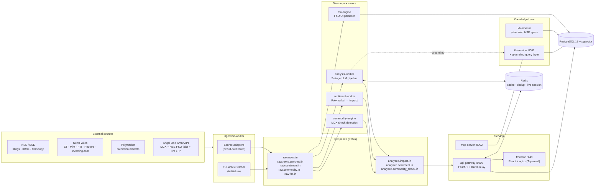
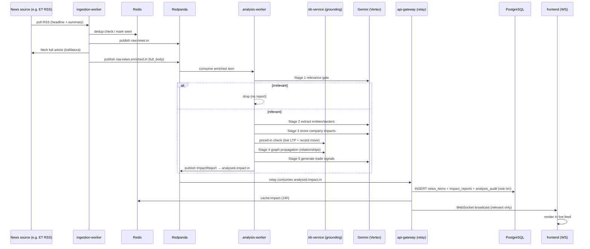
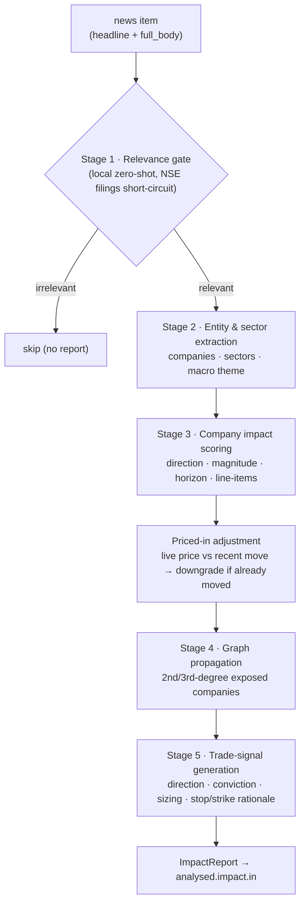
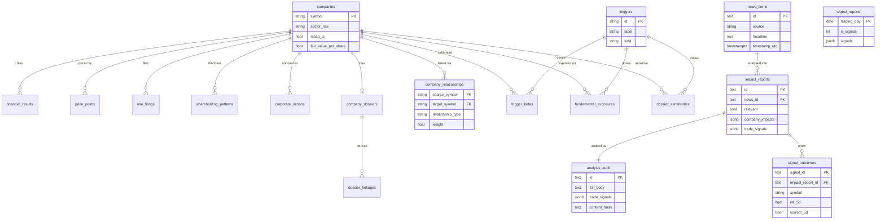

<h1 align="center">Bharat Terminal</h1>

<p align="center">
  <strong>Indian equity market-intelligence engine — maps macro triggers to the companies they move, in near-real time.</strong><br/>
  <em>Public brand: Taperead</em>
</p>

<p align="center">
  
  
  
  
  
</p>

---

## 1. What this is (read this first)

Bharat Terminal ingests Indian-market **news, regulatory filings, prices, and macro/commodity data**, runs each item through a multi-stage LLM analysis pipeline, and produces **structured, channel-attributed intelligence**:

- **Impact reports** — for a news event, *which* NSE/BSE companies are affected, in which direction, how strongly, and over what horizon.
- **An impact graph** — macro triggers (crude, gold, USD, rates…) mapped to **1st-, 2nd-, and 3rd-degree** exposed companies.
- **Pre-computed company dossiers** — CFA-level, citation-backed company write-ups (financials, sensitivities, linkages, risks, catalysts).
- **Trade signals** — direction + conviction + sizing rationale, with a **forward-return accuracy tracker**.

**Target users:** analysts at sub-₹2,000 Cr AUM PMS / AIF firms in India.

It is a **self-hosted system**, not a SaaS: one `docker compose` stack on a single VM, Postgres for state, Redpanda (Kafka) as the event bus, and Gemini (via GCP Vertex AI) for the LLM stages.

> **The core idea in one sentence:** *"news breaks → who is exposed, how much, and is it already priced in?" — answered automatically and stored.*

---

## 2. High-level architecture



Every box except `fno-engine` is a long-running container today (see [§9 Operational state](#9-operational-state)).

---

## 3. End-to-end data flow (news → feed)

1. **Ingest.** `ingestion-worker` runs one async adapter per source. News items are deduped (Redis) and published to **`raw.news.in`**. Web articles are also queued to the **full-article fetcher**, which scrapes the body (trafilatura) and republishes to **`raw.news.enriched.in`** with `full_body`. Filings / sentiment / skip-fetch items are published body-less straight to the enriched topic, so **every item reaches `raw.news.enriched.in` exactly once**.
2. **Analyse.** `analysis-worker` consumes **`raw.news.enriched.in`** and runs the [5-stage pipeline](#4-the-analysis-pipeline). During market hours it processes each item in real time; off-hours it triages in cost-efficient batches and escalates strong items to the full pipeline. Output is an **`ImpactReport`** published to **`analysed.impact.in`**.
3. **Persist + serve.** `api-gateway` consumes **`analysed.impact.in`** and, in one transaction, writes `news_items`, `impact_reports`, and an immutable `analysis_audit` row, then broadcasts to WebSocket clients. The React frontend reads the REST/WS API (proxied through nginx).
4. **Parallel streams.** `sentiment-worker` turns Polymarket probabilities into impact reports; `commodity-engine` detects MCX price shocks and emits impacts/signals; `fno-engine` persists F&O OI ticks. The **knowledge base** (`kb-monitor` + `kb-service`) keeps financials, prices, shareholding, corporate actions and company profiles current, and exposes a **grounding query layer** the analysis pipeline and dossier agent call for ground-truth numbers.

### Trace of one news item → the live feed



---

## 4. The analysis pipeline

A LangGraph state machine (`bharat_terminal/analysis/pipeline.py`). All LLM stages call **Gemini via the provider-agnostic wrapper** (`bharat_terminal/llm/wrapper.py`).



| Stage | Does | Notes |
|---|---|---|
| 1 — Relevance | Filter market-relevant news | Local zero-shot classifier (cheap); NSE/BSE filings are always relevant |
| 2 — Extraction | Pull companies, sectors, macro theme | LLM tool-call; resolves names → NSE symbols |
| 3 — Impact | Score per-company impact | sentiment, magnitude 1–5, time horizon, affected line-items |
| Priced-in | Down-weight already-priced-in moves | uses **live equity LTP** (Angel One) vs the recent trailing move |
| 4 — Propagation | Traverse `company_relationships` | derives 2nd/3rd-degree exposures |
| 5 — Signals | Generate trade signals | long/short, conviction, position-size %, stop-loss & strike rationale |

**Post-hoc accuracy** is tracked separately by `research/score_signals.py`: it explodes signals into `signal_outcomes`, computes forward returns at **1/5/10/20 trading days** from `price_points`, and marks each **successful** (moved >1% in the predicted direction), **bad** (moved >1% against), or **inconclusive** (±1% dead-band). High-conviction signals are measurably the strongest cohort.

---

## 5. Components (one line each)

| Package / service | Role |
|---|---|
| `ingestion/` → **ingestion-worker** | Source adapters + full-article fetcher → Kafka |
| `analysis/` → **analysis-worker** | 5-stage LLM impact/signal pipeline + guardrails |
| `sentiment/` → **sentiment-worker** | Polymarket prediction markets → impact reports |
| `commodity/` → **commodity-engine** | MCX tick ingestion + price-shock detection |
| `fno_engine/` → **fno-engine** | NSE F&O OI tick persistence (`derivative_ticks`) |
| `kb/` → **kb-service** (:8001), **kb-monitor** | NSE XBRL/financials/prices/shareholding/corp-action sync; DCF; company profiles |
| `grounding/` | Read-only DB query layer (financials, price returns) used by analysis + dossiers |
| `research/` | Dossier agent (Gemini), trigger-beta calibration, signal scoring, daily signal reports |
| `mcp_server/` → **mcp-server** (:8002) | Exposes grounding tools over MCP to external agents |
| `llm/` | Provider-agnostic LLM wrapper (Gemini/Claude via Vertex), per-call timeouts |
| `api/` → **api-gateway** (:8000) | FastAPI REST + WS, Kafka→DB relay, Google-OAuth auth |
| `frontend/` → **frontend** (:80/:443) | React + Vite terminal UI behind nginx |
| `alerts.py` + `analysis/guardrails.py` | Pipeline guardrails + Teams/SMTP alerting |

---

## 6. Data model (PostgreSQL)

Schema is managed by **Alembic** (`migrations/versions/`, currently at revision `014`).



> Most links above are **logical** (joined on `symbol` / `id` / `trigger_id`), not enforced FK constraints — the schema favours append-only event tables over rigid foreign keys.

**Reference / knowledge base**
- `companies` — master + profile (sector, mcap, TTM financials, ratios, DCF fair value)
- `financial_results` — quarterly/annual XBRL financials (incl. per-sector lines for banks/insurers)
- `price_points` — daily NSE bhavcopy OHLCV
- `nse_filings`, `result_events`, `corporate_actions`, `shareholding_patterns`
- `company_relationships` — directed company-to-company edges (powers graph propagation)

**Analysis output**
- `news_items` — ingested news (headline + RSS summary)
- `impact_reports` — per-event relevance, company impacts, trade signals (JSONB)
- `analysis_audit` — **immutable** per-event record: exact model input (`full_body`), output, provenance, content hash (compliance)
- `signal_outcomes` — per-signal forward returns + correctness
- `signal_reports` — per-trading-day actionable-signal report (15:30 IST cutoff → next session)

**Research / triggers**
- `company_dossiers`, `dossier_linkages`, `dossier_sensitivities` — pre-computed dossiers + their derived edges
- `triggers`, `macro_events`, `trigger_betas`, `fundamental_exposures` — the macro-trigger catalog + calibrated betas/exposures

**Markets / derivatives**
- `derivative_ticks`, `participant_oi`

**Platform**
- `app_users` (invite allowlist for Google OAuth), `sync_log`

---

## 7. Tech stack & infrastructure

- **Language:** Python 3.12 (services), TypeScript/React 18 + Vite (frontend)
- **Datastore:** PostgreSQL 15 + `pgvector`; Redis (cache, dedup, live-session reuse)
- **Event bus:** Redpanda (Kafka-compatible) — see topics in [§2](#2-high-level-architecture)
- **LLM:** Gemini via **GCP Vertex AI** (e.g. `gemini-3.1-pro-preview` for dossiers); provider-agnostic wrapper with a per-call timeout budget
- **Orchestration:** Docker Compose; a `systemd` unit auto-starts the stack on VM boot
- **Observability:** Prometheus + Grafana; Teams/SMTP guardrail alerts
- **Deployment:** single GCP VM (`asia-south1-c`); nginx terminates TLS and proxies `/api` + `/ws` to the api-gateway (Cloudflare in front)

---

## 8. Running it

```bash
cp .env.example .env          # fill in DB, Vertex/GCP, Angel One, Google OAuth, alert webhook
docker compose up -d          # brings up the full stack
docker compose run --rm kb-migrate   # apply Alembic migrations (alembic upgrade head)
```

**Key configuration groups in `.env`** (see `.env.example` for the full annotated list):
- `DATABASE_URL`, `REDIS_URL`, `KAFKA_BOOTSTRAP_SERVERS`
- `VERTEX_PROJECT` / model selection (`DOSSIER_MODEL`, `GROUNDING_MODEL`, `RELEVANCE_*`)
- `ANGEL_ONE_*` (MCX/F&O ticks + live equity LTP)
- `GOOGLE_CLIENT_ID` (frontend + backend OAuth; access is gated by the `app_users` allowlist)
- **Guardrails/alerting:** `ITEM_PROCESSING_TIMEOUT_S`, `*_COST_BUDGET_USD`, `ALERT_WEBHOOK_URL` (Teams/Slack/Discord) or `SMTP_*`

Secrets live only in `.env` (git-ignored) — never commit it.

Common entrypoints:
```bash
# generate / refresh a per-trading-day signal report
docker compose run --rm kb-migrate python -m bharat_terminal.research.signal_report --latest
# evaluate signal accuracy (ingest + forward returns)
docker compose run --rm kb-migrate python -m bharat_terminal.research.score_signals all
```

---

## 9. Operational state

> This project has a documented history of docs over-claiming. The table below reflects **verified state as of 2026-06-30** — what is actually populated/running, not what is merely coded.

**Running services:** postgres, redis, redpanda, ingestion, analysis, sentiment, commodity, kb-service, kb-monitor, mcp, api, frontend, prometheus, grafana. **Not currently running:** `fno-engine` (opt-in).

**Populated tables (live row counts, approx):** `price_points` ~598k · `nse_filings` ~55k · `financial_results` ~54k · `impact_reports` ~23k · `news_items` ~22k · `corporate_actions` ~17.5k · `shareholding_patterns` ~8.9k · `companies` 2,367 · `dossier_linkages` ~2.1k · `analysis_audit` ~1.9k · `result_events` ~1.8k · `company_relationships` ~1.7k · `dossier_sensitivities` ~1.6k · `signal_outcomes` ~900 · `company_dossiers` 469 · `trigger_betas` 362 · `fundamental_exposures` 123 · `signal_reports` 14.

**Scaffolded (schema exists, 0 rows):** `derivatives_eod`, `sector_leaders`, `universe_membership`.

**Known characteristics / caveats:**
- `financial_results` is current to the latest filed quarter (the historical Dec-2024 freeze is resolved).
- The off-hours batch path and full-article inputs make per-item latency seconds-to-tens-of-seconds (not sub-5s); the pipeline is bounded by per-item/batch **timeouts** and **cost budgets** with breach **alerting**.
- The relevance gate is a local zero-shot model — strong on Indian filings/companies, weaker at geo-filtering pure foreign-stock wire noise (mitigated by curating source feeds).
- Investing.com is **headline-only** (article pages are Cloudflare-locked); it is treated as a macro-headline source.

---

## 10. Repository layout

```
bharat_terminal/
  ingestion/      source adapters, full-article fetcher, Kafka producer
  analysis/       LangGraph pipeline (stages 1–5), guardrails, alerting core
  sentiment/      Polymarket → impact bridge
  commodity/      MCX shock detector
  fno_engine/     F&O OI persister
  kb/             NSE sync pipeline, kb-service API, live price, DCF
  grounding/      read-only DB query layer for LLM grounding
  research/       dossier agent, beta calibration, signal scoring/reports
  llm/            provider-agnostic Vertex/Gemini wrapper
  mcp_server/     MCP server exposing grounding tools
  api/            FastAPI app, routes, Kafka relay, auth
  alerts.py       shared alerting entrypoint (Teams/SMTP)
frontend/         React + Vite + nginx (Taperead UI)
migrations/       Alembic migrations (001–014)
docker/           per-service Dockerfiles + nginx config
docker-compose.yml
```

---

## 11. License

MIT — see [LICENSE](LICENSE).
